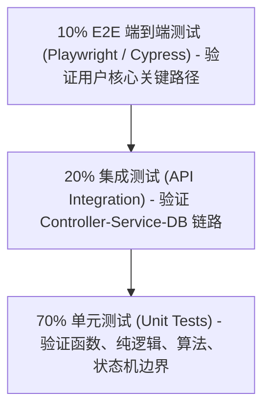
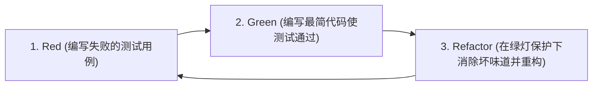

# 自动化测试与质量工程规范 (Test Automation & Quality Engineering)

本技能为 AI Agent 在构建、重构及交付软件功能时提供**工业级自动化测试方法论与质量守护标准**。

---

## 一、 测试金字塔与资源分配法则 (The Testing Pyramid)

在设计自动化测试体系时，严格杜绝“冰淇淋蛋卷反模式”（过多依赖脆弱缓慢的 UI/E2E，几乎没有底层单测）：



1. **单元测试 (70%)**：
   - **特点**：毫秒级执行、内存中运行、零网络/磁盘 I/O 外部依赖（全部通过 Mock/Stub 隔离）。
   - **目标**：覆盖业务规则、状态转换、数据转换、金额与计算推导引擎。
2. **集成测试 (20%)**：
   - **特点**：启动真实或内存轻量数据库（如 SQLite in-memory 或 Testcontainers Docker），验证 ORM 映射、事务提交回滚、HTTP 路由解析。
3. **端到端测试 (10%)**：
   - **特点**：全链路黑盒测试，仅覆盖最重要的主干交易闭环（如“登录 → 下单 → 支付 → 查询账单”）。

---

## 二、 单元测试 AAA 原则与 Mocking 规范

### 1. AAA 结构标准 (Arrange-Act-Assert)
每个测试用例必须清晰分为三段，职责分明：

```python
def test_calculate_discount_vip_user_returns_correct_amount():
    # 1. Arrange (准备上下文、测试数据、Mock 桩)
    user = User(is_vip=True, credit_score=750)
    order = Order(total_amount=100.0, user=user)
    service = PricingService()

    # 2. Act (执行被测目标函数)
    final_amount = service.calculate_final_price(order)

    # 3. Assert (严格断言结果与状态变更)
    assert final_amount == 80.0, "VIP 用户应享受 8 折优惠"
    assert order.discount_applied is True
```

### 2. 外部依赖隔离法则 (Mocking Guidelines)
- **只 Mock 外部不可控系统**：网络调用、短信/邮件网关、系统时间（`freeze_gun`）、外部微服务。
- **严禁 Mock 领域内纯对象**：值对象（Value Object）、无副作用的数据传输对象（DTO）必须使用真实实例，不滥用 Mock。
- **断言行为 (Behavior Verification)**：当测试写入审计日志或发送通知时，必须断言 Mock 的调用次数与具体参数：
  ```python
  mock_mailer.send.assert_called_once_with(to="admin@org.com", subject="Alert")
  ```

---

## 三、 边界值与变异测试矩阵 (Boundary Value Analysis)

仅写“快乐路径（Happy Path）”的测试不是合格的测试。测试用例必须穷举以下边界值矩阵：

| 变量类型 | 必须覆盖的边界与异常用例 |
| :--- | :--- |
| **数值 (Numbers)** | `0`、`-1`、最小/最大整型（`2^31 - 1`）、浮点精度问题（如 `0.1 + 0.2 != 0.3`） |
| **字符串 (Strings)** | 空字符串 `""`、仅空白字符 `"   "`、超长字符串（10,000+ 字符）、包含 Emoji 与单双引号特殊字符 |
| **集合/列表 (Collections)** | 空列表 `[]`、单元素列表 `[x]`、重复元素列表 `[x, x]`、超过分页上限的大列表 |
| **时间 (Datetime)** | 跨年/跨月临界点、闰年 2 月 29 日、跨时区转换（UTC vs 局部时区） |
| **网络与连接 (Network)** | 超时（Timeout）、连接中断（Connection Refused）、返回 500 内部错误、返回畸变 JSON |

---

## 四、 测试驱动开发 (TDD) 红-绿-重构循环

当面对高复杂度、重逻辑模块开发时，必须遵循 TDD 闭环：



1. **Red**：先思考接口定义与断言结果，写出报错的单元测试（确保测试自身有效）。
2. **Green**：用最快最直接的方式实现功能，让测试用例变绿。
3. **Refactor**：在已有测试套件全绿的安全网保护下，提取抽象、消除重复、优化可读性。

---

## 五、 测试工程交付自检清单 (Test Checklist)
- [ ] 测试运行是否**独立且确定**（无前后用例依赖，任何顺序执行均通过）？
- [ ] 测试是否在完成前清理了副作用（回滚事务、清理临时文件）？
- [ ] 核心计算与业务决策函数的**分支覆盖率（Branch Coverage）**是否达到 85%+？
- [ ] 边界测试是否验证了非空防御、越界处理与合法性拦截？
- [ ] 单个测试执行速度是否受控（单元测试套件整体在数秒内完成）？
